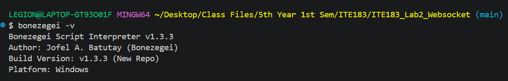
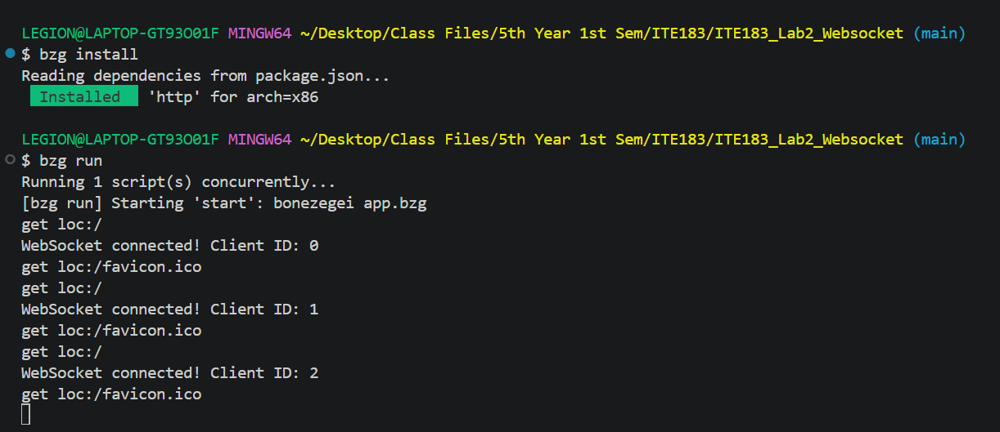
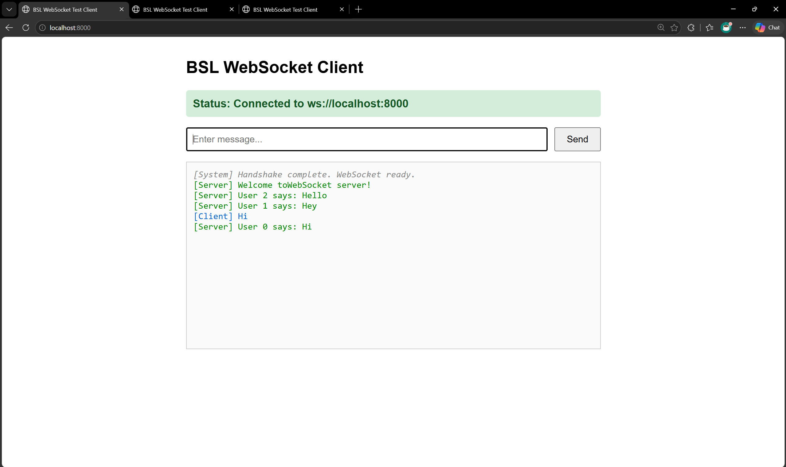
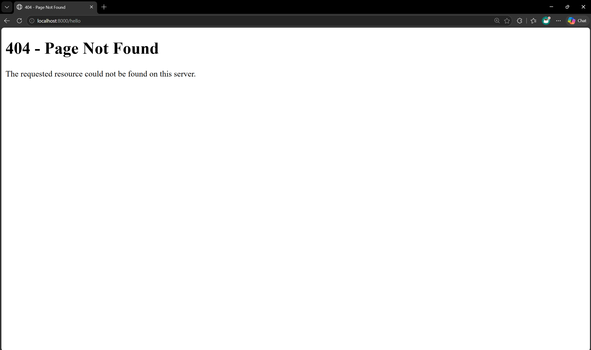
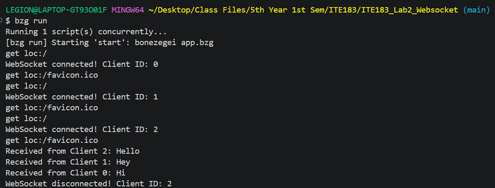

# ITE183_Lab2_Websocket

BSL WebSocket Server is a real-time, multi-client chat server built with the Bonezegei Scripting Language (BSL) v1.3.3. It serves static pages over HTTP (`/` and a custom 404 fallback), upgrades connections to WebSocket, tracks each client by a unique ID, and broadcasts every message to all connected clients using `server.sendAll()`.

## Requirements

- [Bonezegei Scripting Language (BSL)](https://github.com/bonezegei/Bonezegei_Scripting_Language) **v1.3.3** interpreter installed
- The `http` package, installed via BSL's package manager (`bzg install`)
- A modern web browser

## Installation

1. Install the BSL interpreter (Windows via Microsoft Store, or Linux/GitHub Codespaces via `.deb`):
```bash
   wget https://github.com/bonezegei/Bonezegei_Scripting_Language/raw/refs/heads/main/Release/Latest/Bonezegei-x86.deb
   sudo apt install ./Bonezegei-x86.deb
```
2. Verify the install:
```bash
   bonezegei -v
```
3. Clone this repository:
```bash
   git clone https://github.com/utthee/ITE183_Lab2_Websocket.git
   cd ITE183_Lab2_Websocket
```
4. Install the dependencies (this generates the `lib/` directory, which is not committed):
```bash
   bzg install
```

## Usage

From the project root directory:

```bash
bzg run
```

Then open `http://localhost:8000/` in two or more browser windows and send messages. Each message appears in every open window as `User <id> says: <message>`.

## Routes

| Route                                              | Response                                   |
| -------------------------------------------------- | ------------------------------------------ |
| `/`                                                | 200 OK - WebSocket chat client page        |
| any other path e.g. /about, /user, /anything, etc. | 404 Not Found - custom fallback page       |

## WebSocket Events

| Handler               | Behavior                                                                  |
| --------------------- | ------------------------------------------------------------------------- |
| `server.onConnect`    | Logs the new client ID and sends a welcome message to that client         |
| `server.onData`       | Receives a client's message and broadcasts it to everyone via `sendAll()` |
| `server.onDisconnect` | Logs the client ID when a connection closes                               |

## Documentations

### Version check

Terminal output of `bonezegei -v` showing version 1.3.3.

### Install and run

Terminal output of `bzg install` followed by `bzg run`, showing the server starting up.

### Chat (`/`)

Multiple browser windows connected to `http://localhost:8000/`, showing a message sent from one client broadcast in real time to all of them.

### 404 (unmapped route e.g. /hello, /user, /anything, etc.)

The custom `404 Not Found` page returned for any route the server doesn't explicitly handle.

### Terminal output

The server running in a terminal, showing connection logs, received messages, and disconnect events.

## License

This project is licensed under the [MIT License](LICENSE).